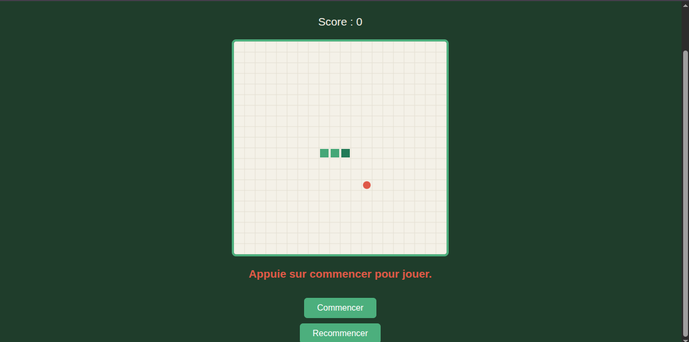

# Snake

Un jeu Snake simple qui se joue dans le navigateur. Le joueur dirige un serpent sur une grille de 20 × 20 cases et lui fait manger des pommes pour grandir et gagner des points. Il doit éviter les murs et son propre corps.

Projet de groupe réalisé en BTS SIO SLAM (Aurlom), en novembre 2026.



## Lancer le jeu

Le jeu utilise des modules JavaScript, qui ne fonctionnent pas si on ouvre `index.html` directement depuis l'ordinateur. Il faut passer par un petit serveur local :

```bash
git clone https://github.com/Rudell65/Snake.git
cd Snake
python3 -m http.server
```

Ensuite, ouvrir http://localhost:8000 dans le navigateur.

## Comment jouer

- Cliquer sur **Commencer**, ou appuyer sur **Espace**, pour démarrer la partie.
- Diriger le serpent avec les **flèches** du clavier ou les touches **ZQSD**.
- Chaque pomme mangée fait grandir le serpent et rapporte 1 point.
- La partie s'arrête si le serpent touche un mur ou son propre corps.
- Cliquer sur **Recommencer** pour rejouer.

## Technologies

- **HTML** : structure de la page
- **CSS** : mise en page et apparence
- **JavaScript** (sans bibliothèque externe) : moteur du jeu, dessin sur un `<canvas>`, gestion du clavier
- **Git et GitHub** : travail en équipe avec branches et Pull Requests

## Organisation des fichiers

| Fichier | Rôle |
|---|---|
| `index.html` | Structure de la page : titre, score, zone de jeu (`canvas`), message, boutons |
| `style.css` | Apparence : page centrée, thème vert, titre, message et boutons stylés |
| `game.js` | Moteur du jeu : déplacement, collisions, score, pomme, dessin, redémarrage |
| `input.js` | Contrôles au clavier : flèches, ZQSD et Espace |
| `script.js` | Point d'entrée : relie la page HTML au moteur du jeu |

La page et le moteur communiquent grâce aux identifiants HTML : `game` (le canvas, obligatoire), `score`, `message`, `start-button` et `restart-button`.

## Équipe et rôles

**Aboubacar** ([danteaboubacar4-byte](https://github.com/danteaboubacar4-byte)) : la page et le visuel
- `index.html` : structure de la page et lien avec le moteur du jeu
- `style.css` : mise en page centrée avec flexbox, thème de couleurs assorti au plateau, boutons avec effet au survol

**Dominique** ([Rudell65](https://github.com/Rudell65)) : le moteur du jeu
- `game.js` : règles du jeu, déplacement du serpent, collisions, score, dessin, redémarrage
- `input.js` : contrôles au clavier
- `script.js` : initialisation du jeu
- Création du dépôt et première version du README

Tout le code est commenté.

## Méthode de travail

- Une branche par tâche (par exemple `aboubacar/style`, `dominique/commentaire`).
- Chaque modification passe par une **Pull Request** relue par l'autre avant d'être fusionnée dans `main`.
- Communication sur Discord : on annonce une tâche avant de la commencer et on prévient après chaque push.
